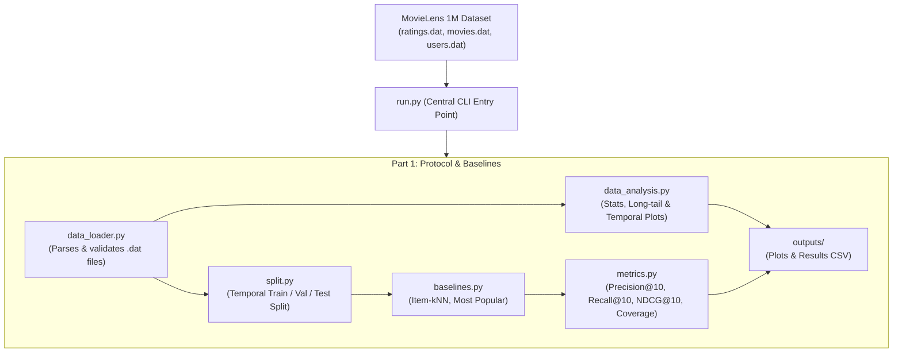

# Recommender Systems - Course Project

A reproducible recommendation pipeline built on the **MovieLens 1M** dataset, developed as coursework for Recommender Systems at Tampere University.

---

## Architecture & Project Structure



```text
recommender_systems_project/
├── run.py                 # Central 1-command entry point
├── README.md              # Project documentation and instructions
├── requirements.txt       # Pinned dependencies
├── data/                  # Ignored from Git
│   └── ml-1m/             # MovieLens 1M dataset files
└── part1/
    ├── __init__.py
    ├── data_loader.py     # Ingestion & schema validation
    ├── data_analysis.py   # Statistical characterization & visualizations
    ├── split.py           # Temporal splitting protocol
    ├── baselines.py       # Item-based kNN and Popularity models
    ├── metrics.py         # Evaluation metrics computed on full catalog
    └── outputs/           # Output directory for figures and tables
```

---

## Quick Start

### 1. Requirements
- Python 3.10+
- Dependencies: `pandas`, `numpy`, `matplotlib`, `scipy`

Install dependencies:
```bash
pip install -r requirements.txt
```

### 2. Execution
Run the complete pipeline with a single command:
```bash
python run.py --data-dir ml-1m --part 1
```
